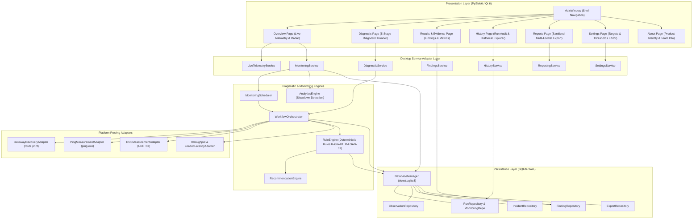

# TicNet — Network Connectivity Diagnosis System

[](https://microsoft.com/windows)
[](https://www.python.org/)
[-41CD52.svg?logo=qt)](https://doc.qt.io/qtforpython-6/)
[-003B57.svg?logo=sqlite)](https://www.sqlite.org/)
[](https://github.com/aiori-hackathon/A3-PS015-TC120/releases/tag/v1.0.0)
[]()
[]()

> 📺 **Team Introduction Video:** [https://youtu.be/n3m9F1AJtcQ](https://youtu.be/n3m9F1AJtcQ)  
> 📄 **Hackathon Submission Document:** [`A3-PS015-TC120.pdf`](A3-PS015-TC120.pdf)
> 🎥 **Ticnet Demonstration Video:** [https://youtu.be/DpqJd_0mcoA](https://youtu.be/DpqJd_0mcoA)
> 📄 **Hackathon Submission Document:** [`A3-PS015-TC120.pdf`](A3-PS015-TC120.pdf)
---

## 🚀 DOWNLOAD TICNET FOR WINDOWS

Evaluators and users can run TicNet immediately on Microsoft Windows **without installing Python, Git, or any third-party development tools**.

### 📦 Direct Downloads:

| Download Package | Format | Direct Download Link | Description |
| :--- | :---: | :---: | :--- |
| **TicNet Portable (Recommended)** | `.zip` | [**Download TicNet_Portable.zip (v1.0.0)**](https://github.com/aiori-hackathon/A3-PS015-TC120/releases/download/v1.0.0/TicNet_Portable.zip) | Complete standalone Windows 64-bit application package. Zero installation required. |
| **All Release Assets** | GitHub | [**GitHub Releases — v1.0.0**](https://github.com/aiori-hackathon/A3-PS015-TC120/releases/tag/v1.0.0) | Official release page with changelog and direct binary downloads. |

### ⚡ Quick Start (No Python Required):
1. **Download** [`TicNet_Portable.zip`](https://github.com/aiori-hackathon/A3-PS015-TC120/releases/download/v1.0.0/TicNet_Portable.zip).
2. **Extract** the ZIP folder to any directory (e.g., `Downloads` or `Desktop`).
3. **Double-click** `TicNet.exe` inside the extracted folder.
4. *TicNet launches immediately!* The SQLite database and runtime configurations are automatically initialized in your secure user AppData directory (`%LOCALAPPDATA%\TicNet\`).

---

## 📌 Project Overview

**TicNet** is an explainable, evidence-backed native Microsoft Windows desktop application engineered to resolve the core dilemma of modern home networking:
> *"Why is my internet not working properly, and whose fault is it?"*

Traditional browser speed tests measure a single peak download speed (e.g., "50 Mbps"), but fail completely when the local router drops DNS queries, cannot distinguish living-room Wi-Fi congestion from upstream ISP fiber degradations, and exhaust bandwidth with heavy transfers.

TicNet solves this through **dual-checkpoint boundary isolation**:
- **Checkpoint 1 — Local Gateway Checkpoint:** Automatically discovers your router (`route print` unprivileged query) and measures local round-trip delay, jitter, and packet loss.
- **Checkpoint 2 — External Internet Checkpoint:** Probes independent global backbones (Cloudflare `1.1.1.1`, Google `8.8.8.8`, Quad9 `9.9.9.9`), direct UDP port 53 DNS queries, and bounded throughput transfers to detect Bufferbloat.

Using **deterministic boolean inference rules** (without black-box hallucinations), TicNet attributes faults with forensic certainty, tracks historical performance over time, and generates sanitized dual-audience action plans for non-technical users and ISP support engineers.

---

## ✨ Core Features

- **Dual-Checkpoint Fault Localization:** Distinguishes internal Wi-Fi/Ethernet router bottlenecks from external ISP backbone failures.
- **5-Stage Deterministic Diagnostic Pipeline:**
  1. *Gateway Discovery:* Unprivileged routing table inspection.
  2. *Gateway Reachability & Delay:* ICMP echo probing to local default gateway.
  3. *Multi-Target External Probing:* Parallel ICMP probes across independent Tier-1 backbones.
  4. *DNS Subsystem Resolution:* Wire-level UDP port 53 queries bypassing OS cache.
  5. *Throughput & Bufferbloat Analysis:* Bounded chunk streaming + concurrent ping latency under load.
- **Continuous Real-Time Telemetry:** Queries native Windows network counters (`netstat -e` / `psutil`) for live Rx/Tx throughput and latency tracking.
- **Scheduled Automated Monitoring:** Configurable scheduler (`30M`, `1H`, `2H`, `DAILY`) with startup recovery for unattended connectivity auditing.
- **Sustained Regression & Incident Detection:** Automated baseline analytics detecting persistent degradations and alerting via desktop notifications.
- **Interactive Time-Series Visualization:** High-DPI hardware-accelerated time-series graphs displaying actual metrics against empirical baselines over 24h, 7d, and 30d windows.
- **Multi-Format Export & Support Ticket Generator:** Exports sanitized Markdown, JSON, and CSV reports ready for submission to ISP customer support.
- **Zero-Trust Privacy Protection:** Automatically sanitizes public WAN IPs, MAC addresses, and username paths before saving to disk.
- **In-Memory Simulation Laboratory:** Quarantined fault simulator with fail-closed safety gates for testing edge cases safely.

---

## 🛠️ Technology Stack

| Layer | Technology | Specification / Version | Purpose |
| :--- | :--- | :--- | :--- |
| **Runtime** | Python | 3.11 / 3.12 (64-bit) | Strict type annotations, dataclasses, standard library |
| **GUI Framework** | PySide6 | 6.8+ (Qt 6) | Native desktop widgets, High-DPI scaling, QSS themes |
| **Visualization** | QtCharts & QPainter | Qt 6 | Hardware-accelerated time-series rendering |
| **Local Storage** | SQLite 3 | WAL Mode (Write-Ahead Log) | Embedded ACID store, non-blocking concurrent GUI reads |
| **DNS Engine** | dnspython | 2.6+ | Direct socket-level UDP queries bypassing OS resolver cache |
| **Configuration** | TOML | tomli / tomli-w | Schema-validated human-readable configuration files |
| **Distribution** | PyInstaller | 6.22+ | Standalone frozen Windows directory distribution |
| **Test Suite** | pytest | 8.0+ | Comprehensive test coverage across UI, unit, integration, and lab |

---

## 🏗️ System Architecture



---

## 📂 Source Code Structure

```
TicNet/
├── config/                                 # Factory configuration templates
│   ├── targets.default.toml                # Diagnostic ICMP, DNS, and HTTP probe endpoints
│   └── thresholds.default.toml             # Diagnostic rule thresholds and sample criteria
├── lab/                                    # Simulated network fault laboratory
│   ├── evaluator.py                        # Post-trial ground-truth precision & recall evaluator
│   ├── ground_truth.py                     # Quarantined synthetic scenario definitions
│   ├── runner.py                           # Multi-scenario trial orchestrator
│   ├── safety_gate.py                      # Fail-closed barrier preventing live network dispatch
│   └── scenarios/                          # Scenarios A (Gateway), B (DNS), C (Loss), D (Congestion)
├── packaging/                              # Windows distribution build scripts
│   ├── build_windows.py                    # Automated PyInstaller build & verification audit
│   ├── README.md                           # Packaging & distribution architecture documentation
│   └── ticnet.spec                         # PyInstaller specification for frozen build
├── src/                                    # Main application source code
│   └── ticnet/
│       ├── configuration/                  # TOML configuration loader and schema validator
│       ├── core/                           # Timezone (IST) and foundation primitives
│       ├── desktop/                        # Native Windows desktop application (PySide6)
│       │   ├── app.py                      # Desktop application entry point (QApplication)
│       │   ├── main_window.py              # Navigation shell and tab container
│       │   ├── paths.py                    # AppData, configuration, and database path resolver
│       │   ├── theme.py                    # High-contrast dark/light styling and tokens
│       │   ├── dialogs/                    # Settings walkthrough, modal, and export dialogs
│       │   ├── pages/                      # 7 Primary view pages (Overview, Diagnosis, etc.)
│       │   ├── services/                   # Service bridges (LiveTelemetry, InternetSpeed, etc.)
│       │   └── widgets/                    # Custom widgets (TimeSeriesLineGraph, Gauges)
│       ├── diagnosis/                      # Deterministic rule engine and recommendation generator
│       ├── measurements/                   # Hardware/OS network adapters (Gateway, Ping, DNS, Load)
│       ├── models/                         # Domain entities, dataclasses, and enums
│       ├── monitoring/                     # Periodic scheduler, baseline computation, slowdown engine
│       ├── persistence/                    # SQLite connection manager, migrations (V001..V006), repos
│       ├── reporting/                      # PDF/CSV/Markdown report generator and privacy masks
│       ├── simulation/                     # Background simulation data generator
│       ├── utils/                          # Logging with privacy redactors and utility functions
│       └── workflow/                       # Staged workflow orchestrator and worker thread
├── tests/                                  # Complete automated test suite
│   ├── desktop/                            # UI, widget, chart, and Qt event loop tests
│   ├── fixtures/                           # Synthetic network response fixtures
│   ├── integration/                        # End-to-end workflow, persistence, and export tests
│   ├── lab/                                # Simulated laboratory scenario & safety gate tests
│   └── unit/                               # Fast offline unit tests for adapters and rule engine
├── .gitignore                              # Git exclusion specification
├── pyproject.toml                          # Standard Python packaging configuration
├── pytest.ini                              # Test runner configuration and test markers
├── requirements.txt                        # Production runtime dependencies
├── requirements-dev.txt                    # Development and test dependencies
├── run_ticnet.bat                          # One-click Windows launch script
└── README.md                               # Project documentation & release guide
```

---

## 💻 Running from Source (Developers)

If you prefer to inspect and run TicNet from source code using Python:

### 1. Prerequisites
- Windows 10 or Windows 11 (64-bit)
- Python 3.11 or Python 3.12 (64-bit)

### 2. Setup Virtual Environment
```powershell
# Clone the repository
git clone https://github.com/aiori-hackathon/A3-PS015-TC120.git
cd A3-PS015-TC120

# Create and activate virtual environment
python -m venv .venv
.\.venv\Scripts\Activate.ps1

# Install runtime dependencies
pip install -r requirements.txt
```

### 3. Launch TicNet
```powershell
# Option A: One-click root script
.\run_ticnet.bat

# Option B: Direct Python execution
python src\ticnet\desktop\app.py
```

### 4. Running Tests
```powershell
# Install dev dependencies
pip install -r requirements-dev.txt

# Run full offline test suite
pytest
```

---

## ⚙️ System Requirements

| Specification | Minimum Requirement | Recommended |
| :--- | :--- | :--- |
| **Operating System** | Windows 10 (64-bit, Version 1909+) | Windows 11 (64-bit, Version 22H2+) |
| **Processor** | Intel Core i3 or AMD equivalent (x64) | Intel Core i5 / AMD Ryzen 5 or higher |
| **RAM** | 2 GB available RAM | 4 GB+ RAM |
| **Disk Space** | 250 MB free disk space | 500 MB+ SSD storage |
| **Network** | Any active Wi-Fi or Ethernet adapter | Active internet connection for external probing |
| **Privileges** | Standard User (`uac_admin=False`) | No Administrator privileges required |

---

## 🔍 Troubleshooting

| Issue | Cause | Solution |
| :--- | :--- | :--- |
| **Windows SmartScreen warning** | Standalone executables built without costly commercial code-signing certificates trigger Windows Defender SmartScreen. | Click **"More info"** and then **"Run anyway"**. TicNet is 100% open-source and builds are fully reproducible from source. |
| **"Gateway Unreachable" in Diagnosis** | Computer is disconnected from Wi-Fi or router is offline. | Verify that your Wi-Fi or Ethernet cable is connected and you have a valid local IP address (`ipconfig`). |
| **Database locked error** | Another instance of TicNet is already running. | Close any other running instances. TicNet uses SQLite WAL mode with busy timeout handling, but single-process writes are best practice. |
| **Antivirus false-positive** | Some aggressive heuristic scanners flag newly packaged PyInstaller bundles. | TicNet is distributed in transparent folder mode (`onedir`) so all DLLs and binaries can be individually audited. Add `TicNet.exe` to antivirus exclusions if prompted. |

---

## 👥 Team TEJAS (AIORI Hackathon)

Developed with pride for the **AIORI Hackathon 2026** by **Team TEJAS**:

| Member | Role / Contributions |
| :--- | :--- |
| **Pushon Bhattacharyya** | System Architecture, UI/UX Presentation Layer, Real-Time Telemetry & Desktop Services |
| **Sudip Barik** | Core Diagnostic Rules Engine, Network Adapters & Measurement Methodology |
| **Tuhin Mondal** | SQLite Persistence Architecture, Historical Analytics & Report Generation Pipeline |

- **Project:** TicNet — Network Connectivity Diagnosis System
- **Repository:** [https://github.com/aiori-hackathon/A3-PS015-TC120](https://github.com/aiori-hackathon/A3-PS015-TC120)
- **Release:** [v1.0.0 — Windows Desktop Release](https://github.com/aiori-hackathon/A3-PS015-TC120/releases/tag/v1.0.0)
- **Team Introduction Video:** [https://youtu.be/n3m9F1AJtcQ](https://youtu.be/n3m9F1AJtcQ)
- **Hackathon Presentation & Submission Document:** [`A3-PS015-TC120.pdf`](A3-PS015-TC120.pdf)
